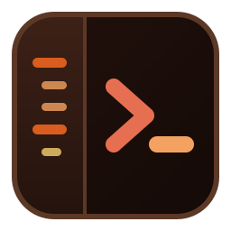
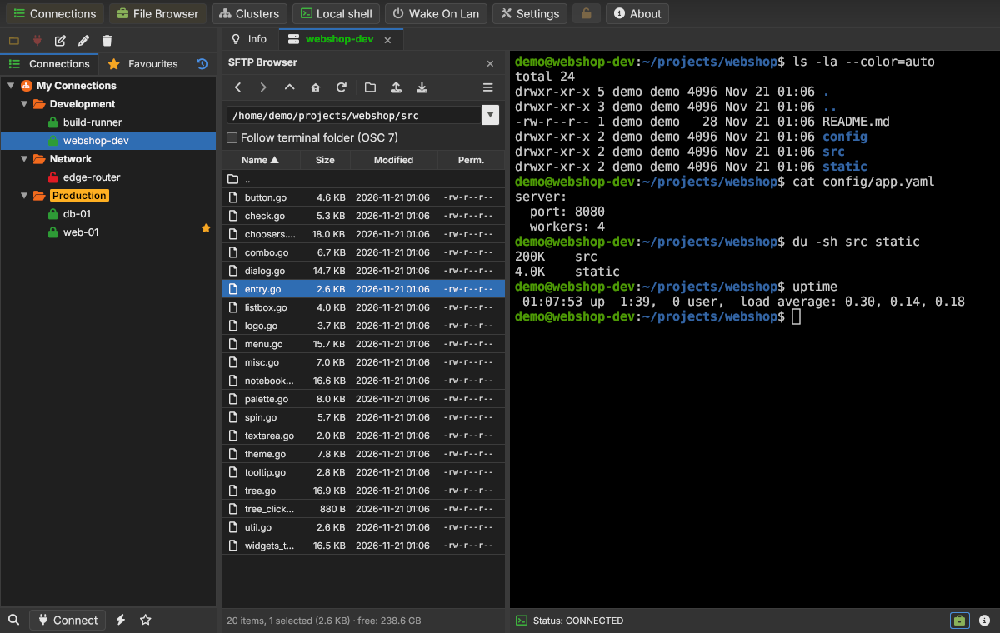
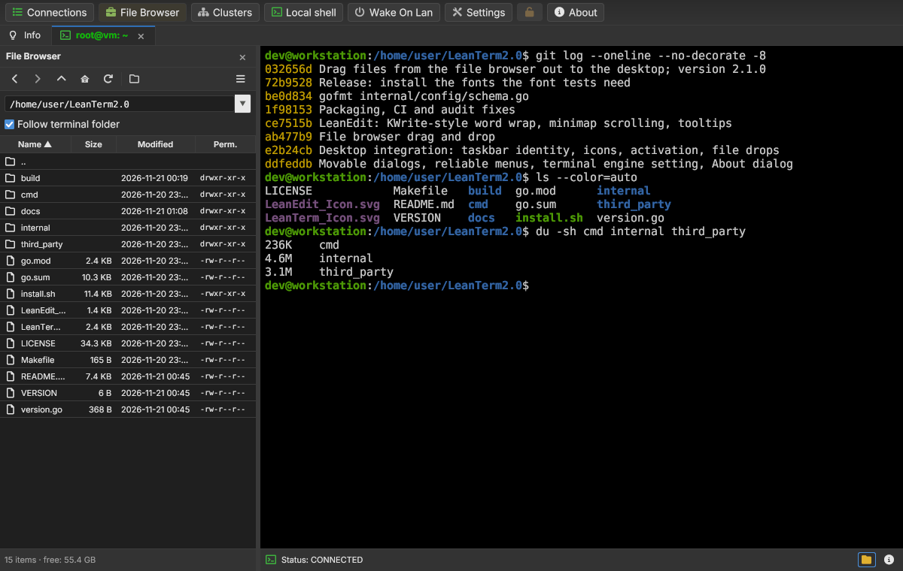
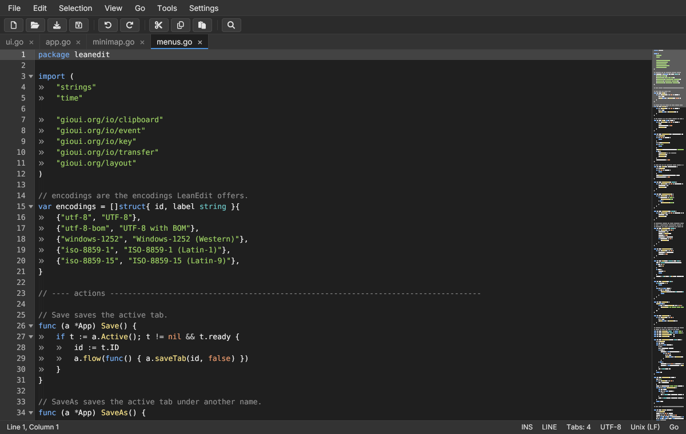

<p align="center"></p>

<h1 align="center">LeanTerm</h1>

<p align="center">
  <b>SSH, Telnet and SFTP connection manager for Linux and Windows</b><br>
  Connection tree, tabbed terminals, a file browser and a built-in editor for remote files, in one lean native application.
</p>

<p align="center">
  <a href="https://github.com/Suvukaraz/LeanTerm2.0/releases/latest"></a>
  
  <a href="LICENSE"></a>
  <a href="https://github.com/Suvukaraz/LeanTerm2.0/actions/workflows/ci.yml"></a>
</p>

<p align="center">
  
  <br>
  <em>LeanTerm with connections, SFTP browser and remote terminal (Ghostty)</em>
</p>

LeanTerm is written in Go with the [Gio](https://gioui.org) GUI toolkit. It keeps your saved connections in an organized tree, opens SSH, Telnet and local shells in tabs or split panes, browses remote (SFTP) or local files side-by-side with the terminal, and edits remote or local files directly in its built-in code editor, LeanEdit.

---

## Screenshots

<p align="center">
  
  <br>
  <b>Figure 1:</b> <em>LeanTerm with connections + SFTP browser + remote terminal (Ghostty)</em>
</p>

<br>

<p align="center">
  
  <br>
  <b>Figure 2:</b> <em>LeanTerm only with file browser and a local shell (VT terminal)</em>
</p>

<br>

<p align="center">
  
  <br>
  <b>Figure 3:</b> <em>LeanEdit with its own source code open</em>
</p>

---

## Features

- **Connections** – SSH (jump hosts, agent, keyboard-interactive and OTP prompts, local, remote and dynamic port forwarding, X11 forwarding), Telnet and local shells, with the protocols implemented in pure Go. No external `ssh` or `sftp` binary is required.
- **Organization & Tree** – Organize connections in folders with favorites and history, quick connect, bulk edit, Wake-on-LAN, and custom variables and prompts in connection settings.
- **Terminals** – Tabbed terminals and split panes (vertical and horizontal), find bar, screenshots, and session logs. Choose between LeanTerm's pure Go VT engine or the high-performance Ghostty terminal engine (libghostty-vt). Local shells use PTY on Linux and ConPTY on Windows.
- **Automation** – Expect-style sequences, pre- and post-connect commands, macros, cluster administration with broadcast input across multiple terminals, and piping/teeing terminal output to files or commands.
- **File Browser** – SFTP for SSH connections and the local filesystem for local shells: drag and drop (drop files from desktop into target folder, move rows between folders, drag files out to desktop/file manager), transfer queue, directory tracking following the terminal (OSC 7), and one-click opening in editor.
- **LeanEdit** – Integrated and standalone text & code editor for local and remote files with syntax highlighting, code folding, word completion, Go to Symbol, bookmarks, minimap, and automatic reload on external changes.
- **Security** – Secrets encrypted with [age](https://age-encryption.org) and stored in the system keyring or behind a master password, KeePassXC integration, and GUI lock screen.

---

## Installation

### Linux (x86_64)

One command for Debian, Ubuntu, Fedora, openSUSE, Arch Linux and their derivatives:

```sh
curl -fsSL https://raw.githubusercontent.com/Suvukaraz/LeanTerm2.0/main/install.sh | sh
```

The script automatically detects your distribution, installs the `.deb` package on Debian/Ubuntu-based systems and the standalone release archive (with required libraries) elsewhere. Every download is verified against release checksums. Running the command again updates LeanTerm.

Command-line options can be passed after `sh -s --`:

```sh
curl -fsSL https://raw.githubusercontent.com/Suvukaraz/LeanTerm2.0/main/install.sh | sh -s -- --version 2.1.1
curl -fsSL https://raw.githubusercontent.com/Suvukaraz/LeanTerm2.0/main/install.sh | sh -s -- --uninstall
```

### Windows 10 (1809) or later

Download and run `leanterm_2.1.1_windows_amd64_setup.exe` from the [Releases page](https://github.com/Suvukaraz/LeanTerm2.0/releases/latest).

The installer sets up LeanTerm in `C:\Program Files\LeanTerm` and creates Start menu and desktop shortcuts. LeanEdit can also be installed (`leanedit.exe`, with its own taskbar identity and "Open with" context menu entry). *Note: The installer is not code-signed yet, so Windows SmartScreen will ask for confirmation on the first start.*

### Packages

All packages and their checksums (`SHA256SUMS`) are available on the [Releases page](https://github.com/Suvukaraz/LeanTerm2.0/releases/latest):

| File | Description |
|---|---|
| `leanterm_2.1.1_amd64.deb` | Debian/Ubuntu package with LeanTerm and LeanEdit |
| `leanterm_2.1.1_linux_amd64.tar.gz` | Portable archive for other Linux distributions (used by `install.sh`) |
| `leanterm_2.1.1_windows_amd64_setup.exe` | Windows installer |

*Linux runtime requirements:* glibc 2.34 or newer, along with EGL, Wayland, X11 and xkbcommon libraries.

---

## LeanEdit

LeanEdit is both the integrated editor inside LeanTerm and a full-featured standalone text and code editor application. It has its own desktop launcher, icon, taskbar identity, and file association:

```sh
leanedit [file…]        # equivalent to: leanterm -leanedit [file…]
```

<p align="center">
  
  <br>
  <em>LeanEdit with its own source code open, featuring tabs, syntax highlighting, and minimap</em>
</p>

- **Independent Window & Process** – LeanEdit operates as a separate application in taskbars (GNOME, KDE, Windows), even when spawned by LeanTerm for editing remote SFTP files.
- **Tabs & Drag-and-Drop** – Drop files onto the editor window to open them as new tabs. By default, opening files from the file manager attaches them to the existing running instance and brings it to front. Use *File → New Window* (`Ctrl+Shift+N`) to spawn additional independent windows.
- **File Watching & Safe Reload** – When the window gains focus, LeanEdit checks whether open files were modified or deleted by another program, prompting to reload without overwriting external edits unintentionally.
- **Language Features** – Syntax highlighting for major programming and config languages, code folding, word completion, Go to Symbol, custom line endings (LF / CRLF), encodings (UTF-8, UTF-8 with BOM, ISO-8859-1, ISO-8859-15, Windows-1252), minimap, and zoom controls.

---

## Configuration

Settings can be customized directly in the application GUI and are stored in TOML format:
- **Linux**: `~/.config/leanterm/config.toml`
- **Windows**: `%APPDATA%\LeanTerm\config.toml`

The UI window layout and state is saved in `state/ui.toml`. Passwords and sensitive credentials are encrypted with age in `secrets.age`.

For a complete reference of all configuration options, see [docs/config-reference.md](docs/config-reference.md).

Command-line flags (such as `--start-uuid`, `--start-shell`, `--edit <file>`, `--leanedit`, and `--config-dir`) can be viewed with `leanterm --help`.

---

## Building from source

**Requirements**: Go 1.26 or newer. On Linux, GUI compilation requires Wayland, X11, EGL, GLES, xkbcommon, Xcursor and libffi development libraries:

```sh
# Debian / Ubuntu:
sudo apt install libwayland-dev libx11-dev libx11-xcb-dev libxkbcommon-x11-dev libgles2-mesa-dev libegl1-mesa-dev libffi-dev libxcursor-dev libvulkan-dev
```

### Standard Build (Pure Go VT Engine)

```sh
go build -o bin/leanterm ./cmd/leanterm
```

Gio and gvcode are vendored with custom enhancements in `third_party/` (see `third_party/gio/LEANTERM.md`): file manager drag-and-drop on X11 and Wayland, per-window application IDs and icons, and smooth window activation.

### Ghostty Terminal Core Build

The official release packages and CI also include the libghostty-vt engine, built using Zig 0.17.1 and enabled via the `ghostty` build tag:

```sh
build/gio/build-libghostty.sh x86_64-linux-gnu.2.34 "$PWD/ghostty/linux"
PKG_CONFIG_PATH="$PWD/ghostty/linux/lib/pkgconfig" go build -tags ghostty -o bin/leanterm ./cmd/leanterm
```

### Packaging Scripts

Packaging scripts in `build/` create release packages using the version from `VERSION`:

| Package | Command |
|---|---|
| Debian / Ubuntu `.deb` | `build/package-deb.sh` |
| Linux `.tar.gz` archive | `build/package-tarball.sh` |
| Windows installer (`.exe`) | `build/package-windows.sh` *(cross-compiled from Linux; requires `nsis` and `go-winres`)* |

### Testing

```sh
go test ./...        # or make test
make build           # builds bin/leanterm without libghostty
```

---

## License

LeanTerm is licensed under the [GNU General Public License v3.0](LICENSE).
